# agentsec

Red-team scanner for LLM apps, AI agents and MCP servers. It sends known attacks (prompt injection, system-prompt leakage, secret exfiltration and tool abuse) and maps each finding to the [OWASP Top 10 for LLM Applications](https://genai.owasp.org/llm-top-10/).

[](https://github.com/Kenzokishi/agentsec/actions/workflows/ci.yml)


It comes with a deliberately vulnerable demo agent, so you can see the attacks work without any API key:

```bash
git clone https://github.com/Kenzokishi/agentsec && cd agentsec
npm ci
npm run demo
```



---

### Em português

O `agentsec` é um scanner de segurança para aplicações com IA. Ele ataca o app (ou um agente, ou um servidor MCP) com injeção de prompt, vazamento do system prompt, roubo de segredos e abuso de ferramentas, e devolve um relatório com nota de 0 a 100 ligado ao OWASP Top 10 para LLM. Vem com um agente vulnerável de exemplo, então roda sem nenhuma chave de API. Também pode rodar no CI e reprovar o build se a nota ficar baixa.

---

## What it tests

| Probe | OWASP | What it checks |
| --- | --- | --- |
| Direct prompt injection | `LLM01` | User text overrides the system prompt |
| System prompt leakage | `LLM07` | The app prints its own hidden instructions |
| Sensitive information disclosure | `LLM02` | A planted secret can be extracted |
| Excessive agency (tool abuse) | `LLM06` | Injected text triggers a sensitive tool call |

Each finding comes with the evidence and a suggested fix.

## Usage

Build once, then run the CLI:

```bash
npm run build

# built-in vulnerable agent
node dist/index.js scan --target demo

# any OpenAI-compatible /chat/completions endpoint
export AGENTSEC_API_KEY=sk-...
node dist/index.js scan --target https://api.openai.com/v1/chat/completions --model gpt-4o-mini

# only some probes, Markdown report
node dist/index.js scan --target demo --probes prompt-injection,excessive-agency
node dist/index.js scan --target demo --report md --out report.md

# list the probes
node dist/index.js list
```

Run `npm link` once if you prefer to call it as `agentsec` from anywhere.

It works with any OpenAI-compatible endpoint: OpenAI, Azure, Groq, Ollama, vLLM, LM Studio or your own gateway.

## In CI

`--fail-under <n>` exits with code 1 when the score is below `n`, so a new prompt-injection hole fails the pipeline:

```yaml
- run: git clone --depth 1 https://github.com/Kenzokishi/agentsec /tmp/agentsec
- run: cd /tmp/agentsec && npm ci && npm run build
- run: node /tmp/agentsec/dist/index.js scan --target "$STAGING_URL" --model gpt-4o-mini --fail-under 80
```

This repository's own CI runs the scanner against the demo agent and fails if the attacks stop being detected.

## How it works

- **Targets** (`src/targets/`): anything you can send a message to. There is the built-in `demo` agent and a generic `http` adapter.
- **Probes** (`src/probes/`): one attack technique each. A probe sends crafted inputs and looks for evidence in the responses.
- **Scanner and report** (`src/core/`, `src/report/`): run the probes, compute the score (100 minus the weight of each vulnerable finding) and print it to the console or as Markdown.

A new probe is one file that exports a `Probe`. A new target is one file with a `send()` method. More details in [`docs/ARCHITECTURE.md`](docs/ARCHITECTURE.md).

## Responsible use

Only test systems you own or are authorized to test. The demo agent is insecure on purpose, to show what the attacks look like.

## Next steps

- MCP target (scan a server's tools over stdio)
- Indirect injection through retrieved documents (`LLM08`)
- HTML report with reproduction steps
- Multi-turn attacks

## License

MIT © Pedro Kenzo
